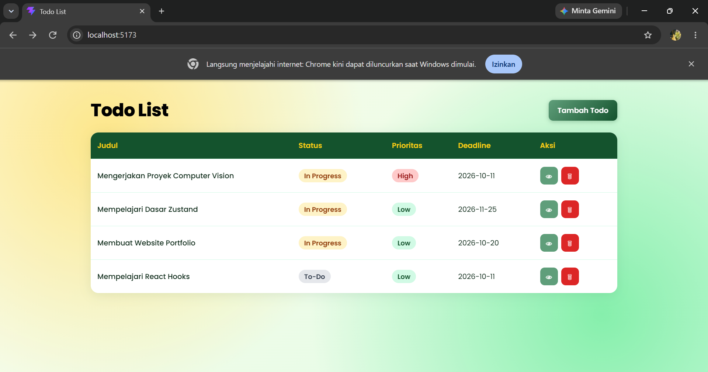
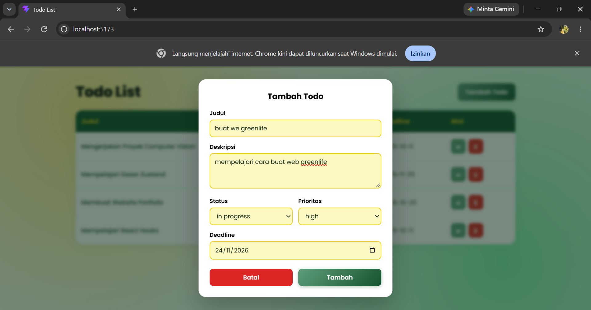
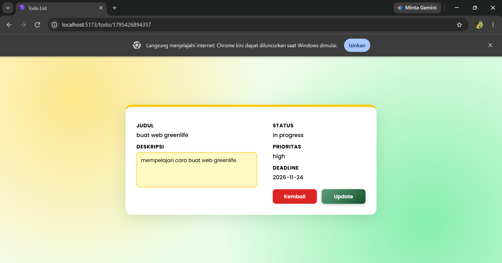
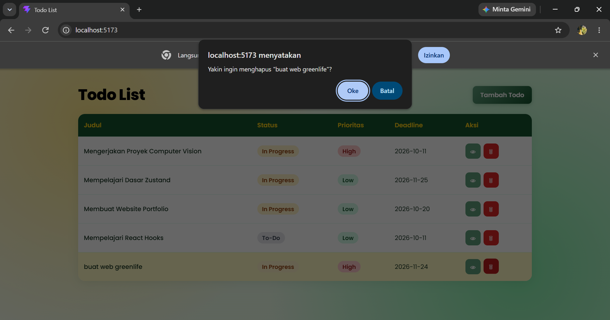
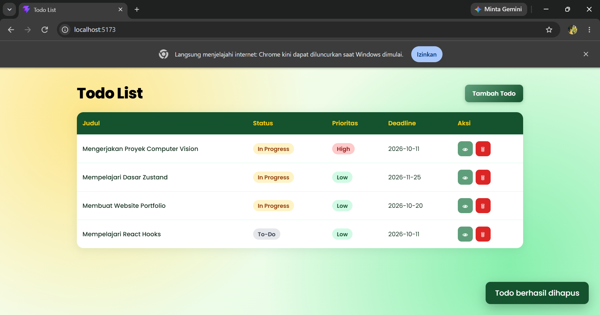
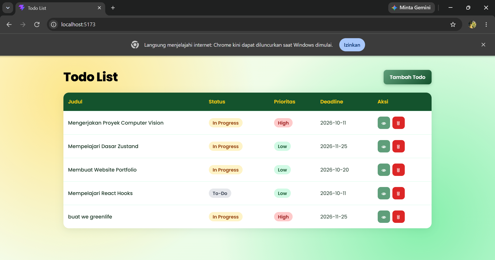

## Screenshot Hasil Implementasi
### 1. Daftar Todo
Halaman utama menampilkan seluruh tugas dari data dummy.

### 2. Tambah Todo
Modal formulir untuk menambahkan tugas baru.

### 3. Setelah Tambah Todo
Tugas baru langsung muncul di tabel tanpa reload halaman.

### 4. Detail Todo
Halaman detail menampilkan informasi lengkap suatu tugas.

### 5. Update Todo
Modal formulir update dengan data tugas yang sudah terisi.

### 6. Konfirmasi Hapus Todo
Dialog konfirmasi muncul sebelum tugas dihapus.

### 7. Setelah Hapus Todo
Tugas yang dihapus langsung hilang dari daftar.

### 8. Setelah Update Todo
Perubahan data tugas langsung tampil di aplikasi.

---

## Pembuat

- **Nama:** _Alia fitri azkia_
- **NIM:** _251401027_
